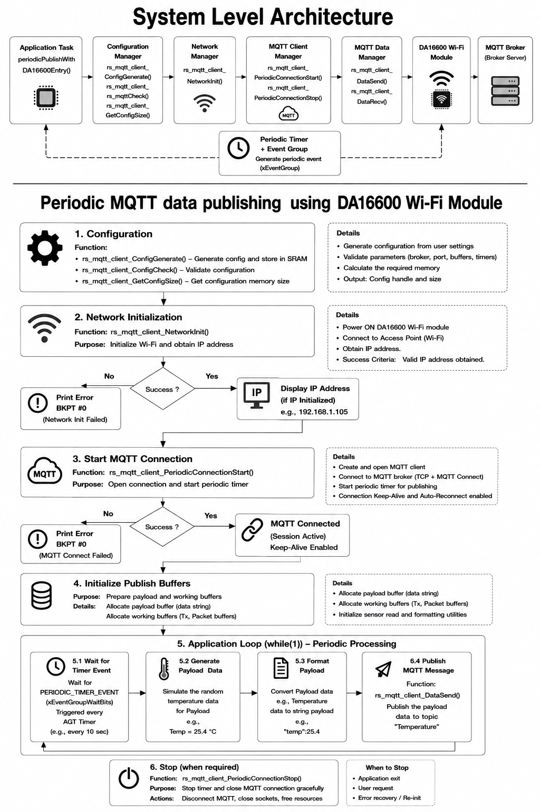
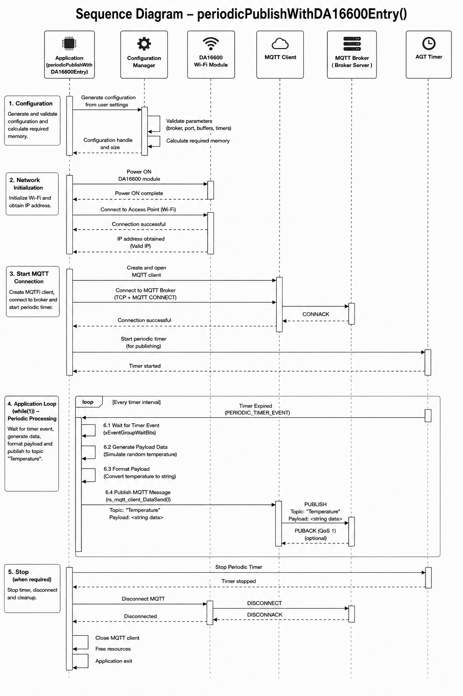

# RS Periodic MQTT Publisher 

## Table of Contents

* [1. Introduction](#1-introduction)
* [2. Hardware and Tool Support](#2-hardware-and-tool-support)
* [3. Importing and Building Application Project](#3-importing-and-building-application-project)
* [4. Project Execution and Expected Results](#4-project-execution-and-expected-results)
* [5. MCU and FSP Resource Use](#5-mcu-and-fsp-resource-use)
* [6. System Level Architecture](#6-system-level-architecture)
* [7. Periodic MQTT Publishing Sequence of events](#7-periodic-mqtt-publishing-sequence-of-events)
* [8. Module Layer Code and Demonstration Code](#8-module-layer-code-and-demonstration-code)
* [9. Configuration Assumptions for the Reference Board](#9-configuration-assumptions-for-the-reference-board)
* [10. MQTT Periodic Publisher API Reference](#10-mqtt-periodic-publisher-api-reference)
* [11. Callback and Supporting Functions](#11-callback-and-supporting-functions)
* [12. Adapting to Your Board](#12-adapting-to-your-board)


---

# 1. Introduction

The RS Periodic MQTT Publisher example demonstrates how a Renesas RA MCU interfaces with the DA16600 Wi‑Fi module to establish wireless network connectivity, connects to an MQTT broker, and periodically publishes application data to a configured MQTT topic.

The MQTT client connects to a configured MQTT broker, which can be either a public broker for evaluation purposes or a private broker deployed in a production environment.

After a successful MQTT connection is established, the application begins periodically publishing data to the configured MQTT topic. In this example, simulated temperature sensor values are generated and transmitted as MQTT messages. The published data can be easily modified to represent actual sensor readings, device status, telemetry information, or application-specific payloads.

The application is designed using a FreeRTOS event-driven architecture, which eliminates the need for continuous polling and improves CPU efficiency. An AGT timer generates periodic timeout events that are posted to the application task. Upon receiving a timer event, the application prepares the MQTT payload and initiates a publish operation through the MQTT client. This event-driven mechanism allows the processor to remain available for other application tasks while maintaining deterministic publishing intervals.

By default, the periodic publish timer is configured for a 10-second interval, causing telemetry data to be sent every 10 seconds. However, this interval can be adjusted according to application requirements, allowing users to increase or decrease the publishing frequency based on network bandwidth constraints, power consumption targets, or data reporting needs.

This example provides a foundational reference for developing IoT applications that require reliable wireless connectivity and periodic telemetry reporting to cloud platforms, MQTT brokers, or edge gateway systems.

## Key Features

- MQTT broker connection through DA16600.
- Event-driven periodic publishing.
- Timer-triggered publish operations.
- Simulated sensor data generation.
- Optional DA16600 MQTT configuration.
- Console-based interface for user I/O operation.
- Preset and user-configurable support.

# 2. Hardware and Tool Support

| Hardware Item | Description |
|---------------|-------------|
| Reference Boards | FPB‑RA6E2 |
| Wi‑Fi Module | (Part Number: US159-DA16600EVZ)(SDK v3.2.8.1)     Reference Link --> (https://www.renesas.com/en/design-resources/boards-kits/us159-da16600evz#overview) |
| Network Connectivity Device| Wi‑Fi Access Point or Wi-Fi Router with internet connectivity |
| USB Cable| Micro USB cable for programming, debugging and observing Project operations on Console |


Note: Please ensure the Pmod™ SDK is up-to-date before executing the project.
For SDK update instructions, please refer to Section 5, 6, and 7 in the provided link: https://www.renesas.com/en/document/apn/da16200da16600-sdk-update-guide

### Software Requirements
* Renesas Flexible Software Package (FSP): Version 6.5.0 or later
* e2 studio: Version 2025-12 or later
* LLVM Embedded Toolchain for ARM: Version 21.1.1
* Terminal Console Application: Tera Term or a similar application
* MQTT Broker - Access to Web based MQTT broker bridge --> [Link](https://mqtt.aarsoftwareserver.com:444/test_client/) 

### Hardware Connections
* Connect the RA board (FPB‑RA6E2) USB debug port to the host PC via a USB cable.
* Connect the Wi-Fi Pmod™(US159-DA16600EVZ) to the RA board PMOD1 port. Ensure that the pin1 of the PMOD is connected to Pin 1 of the connector.
* Connect a wire between J1-10 and J1-5 to accommodate UART0 for the virtual console.

### Connecting and Running a Broker 

* Open the MQTT.Cool Test Client: https://mqtt.aarsoftwareserver.com:444/test_client/

  From the drop-down menu of select a broker, select:   tcp://broker.hivemq.com:1883

* Click connect to establish the MQTT connection. After a successful connection, a green indicator will appear next to the selected broker, confirming connectivity.

* To subscribe to a topic:   Navigate to the Subscriptions section.   Enter "Temperature" as the topic under the window "topic filter field". Set QoS to 0.  Click Subscribe.
  Note: You will notice the Temperature topic is listed under Subscribed topics window.
  Once the subscription is active, any clients publishing to the "Temperature" topic will appear in the Messages section.

* For quick verification of the message publishing and broker functionality:

  In the Publish section.
  Enter "Temperature" as the topic name in the window "The destination of the message", and sample data as the message payload in the window "The message text to be sent".  Click Publish.

  Published messages should appear in the Messages Console, confirming successful message delivery.

  

*  This test client can be used to verify MQTT broker connectivity, validate topic subscriptions, and confirm message publishing and reception functionality. Now the MQTT Broker is ready to receive the published messages from the RA Board. 

  Note: Before connecting the RA Board, ensure that the MQTT broker is running and reachable from the network. 
  Note: Public MQTT brokers are intended only for evaluation purposes. For production deployments use a private broker and enable TLS.
2
For production deployments use a private broker and enable TLS.

# 3. Importing and Building Application Project
1. Import the project into e2studio using File → Import → Existing Projects into Workspace and select the MQTT_Periodic_Publisher_with_DA16600_On_FPB_RA6E2 project. 

#### Configure Wi-Fi Credentials

2. Open the `user.h` file located in the `src` folder.
3. Update the Wi-Fi SSID and password definitions to match your Access Point (AP) or router credentials.

#### Example
 
```c
#define WIFI_SSID "YOUR_WIFI_SSID"
#define WIFI_PWD "YOUR_WIFI_PASSWORD"
```
 
> **Note:** Ensure that `WIFI_SSID` and `WIFI_PWD` are set to the correct credentials for your Wi-Fi network.

4. Build the project (Project → Build All).

5. Before running the Application project, make sure the hardware-connections are properly completed.
6. Download the image to the RA board using the USB debug port. Debug using Run → Debug As → Renesas GDB Hardware Debugging.

7. Open a serial terminal application (e.g., Tera Term) on the host PC and connect to the COM port provided by the J-Link OB VCOM. The configuration parameters of the serial port on the serial terminal application are as follows:
    * Speed: 115200
    * Data: 8 bit
    * Parity: none
    * Stop bits: 1 bit
    * Flow control: none

# 4. Project Execution and Expected Results

```
Example Terminal Output
******************************************************************
   Periodic MQTT Publisher Demo with DA16600 Wi-Fi Module
   Demo Version 1.0.0
******************************************************************

*   Flex Software Pack Version  6.5.0                            *

******************************************************************
Refer to documentation file for more details on Demo Project and
FSP User's Manual for more information about module drivers

The project demonstrates an RA MCU working with the DA16600 Wi-Fi
module to connect to a Wi-Fi network and communicate with an MQTT
broker. The demo periodically publishes messages to the configured
MQTT broker, where the received messages can be viewed and verified
demonstrating successful MQTT communication and cloud connectivity.
******************************************************************

Users can view the informational and error messages on the console

******************************************************************

Wi-Fi connection successful!

IP Addr of the Board: 192.168.86.130

Disabling TLS mode for the Demo on DA16600 Module...

MQTT initialization Successful and starting the connection!

MQTT client is successfully connected to "broker.hivemq.com"
and ready for periodic publishing!

Iteration = 1
Published Temperature Data = 73.450005

Iteration = 2
Published Temperature Data = 72.527092

Iteration = 3
Published Temperature Data = 72.957451


```
# 5. MCU and FSP Resource Use

| Item | Description |
|--------|------------|
| Timer | r_agt - (AGT Periodic Timer) |
| UART | r_sci_uart - (User interface and Console Communication) |
| MQTT Client |  rm_mqtt_onchip_da16xxx - (On Chip MQTT Client)  |
| Wi‑Fi Driver | rm_wifi_da16xxx (WiFi DA16600)  |
| UART | rm_at_transport_da16xxx_uart (For AT Command Communication) |
| DTC | r_dtc (Data Transfer)  |
| Event Synchronization | FreeRTOS Event Groups |

---

## Module Summary

| Module |  Key Configuration | Purpose |
|----------|-------------------|---------|
| MQTT On-Chip DA16xxx | MQTT client to Connect to HiveMQ broker | MQTT communication service |
| DA16xxx Wi-Fi | Country Code = US, SNTP enabled | Wireless connectivity and time synchronization |
| Wi-Fi Common | Default Wi-Fi framework configuration | Wi-Fi support services |
| AT Transport DA16xxx UART | Uses UART9 transport interface | AT command communication layer |
| SCI UART | Channel 9, 115200 baud, 8N1, RTS flow control, internal clock, interrupt priority 12 | UART communication interface for DA16xxx Wi-Fi module |
| DTC Transfer (RX) | Normal mode, 2-byte transfer size, fixed source/destination address, interrupt on transfer end | DTC transfer configuration for UART RX operations |
| DTC Transfer (TX) | Normal mode, 2-byte transfer size, fixed source/destination address, interrupt on transfer end | DTC transfer configuration for UART TX operations |


## MQTT Configuration
| Parameter | Value |
|------------|--------|
| MQTT Version | v3.1.1 |
| Broker Host | `broker.hivemq.com` |
| Broker Port | `1883` |
| Keep Alive | 60 Seconds |
| Clean Session | Enabled |
| RX Timeout | 10 Seconds |
| TX Timeout | 10 Seconds |
| Client ID | Not Configured |
| Username | Not Configured |
| Password | Not Configured |
| Will Topic | Not Configured |
| Will Message | Not Configured |
| MQTT Callback | `mqtt0_callback` |
| Root CA | `ROOT_CA` |
| Client Certificate | `CLIENT_CERT` |
| Private Key | `PRIVATE_KEY` |
---
## Wi-Fi Configuration
| Parameter | Value |
|------------|--------|
| Wi-Fi Module | DA16xxx |
| Country Code | US |
| SNTP Server | `216.239.35.0` |

---
## UART Configuration

| Parameter | Value |
|------------|--------|
| UART Instance | `g_uart9` |
| Channel | 9 |
| Baud Rate | 115200 |
| Data Bits | 8 |
| Parity | None |
| Stop Bits | 1 |
| Flow Control | RTS |
| Clock Source | Internal Clock |
| RX Start Edge | Falling Edge |
| Noise Cancellation | Disabled |
| RX FIFO Trigger | Maximum |
| Callback | `NULL` |
| RXI Interrupt Priority | 12 |
| TXI Interrupt Priority | 12 |
| TEI Interrupt Priority | 12 |
| ERI Interrupt Priority | 12 |

---
## DTC Transfer Configuration

| Parameter | RX (`g_transfer1`) | TX (`g_transfer0`) |
|------------|-------------------|-------------------|
| Mode | Normal | Normal |
| Transfer Size | 2 Bytes | 2 Bytes |
| Source Address Mode | Fixed | Fixed |
| Destination Address Mode | Fixed | Fixed |
| Repeat Area | Source | Source |
| Interrupt | Transfer End | Transfer End |
| Number of Descriptors | 1 | 1 |
| Activation Source | Disabled | Disabled |

---

# 6. System Level Architecture

## Functional Overview

The periodicPublishWithDA16600Entry() function implements a periodic MQTT publishing workflow using the DA16600 Wi-Fi module. The application begins by generating the MQTT client configuration from user-defined settings, validating communication parameters such as broker address, port number, buffer sizes, and timer settings, and calculating the required memory resources. The DA16600 Wi-Fi module is then powered on and connected to the configured wireless access point. Upon successful network initialization and acquisition of a valid IP address, the application establishes an MQTT connection with the broker and starts a periodic timer used to trigger data publishing events.

After the MQTT session is established, the application allocates the payload and working buffers required for message creation and transmission. During runtime, the application continuously waits for a periodic timer event generated by the AGT timer through the FreeRTOS Event Group mechanism. Each timer expiration triggers the generation of simulated temperature data, which is then formatted into a string-based payload suitable for MQTT transmission. The formatted payload is published to the MQTT topic "Temperature" using the rs_mqtt_client_DataSend() API. This process repeats at the configured interval (for example, every 10 seconds), providing a lightweight and scalable framework for periodic sensor-data publishing over MQTT. When the application is terminated or a stop condition occurs, the MQTT connection is gracefully closed and all allocated resources are released.



# 7. Periodic MQTT Publishing Sequence of events
## Sequence of Events Overview

The `periodicPublishWithDA16600Entry()` function demonstrates the complete workflow for periodically publishing MQTT messages using the DA16600 Wi-Fi module. The application begins by generating the required configuration, establishes network connectivity, connects to the MQTT broker, starts a periodic AGT timer, and repeatedly publishes temperature data until the application is stopped. Finally, it performs a graceful shutdown by stopping the timer, disconnecting from the broker, and releasing all allocated resources.

### 1. Configuration

The application begins by generating a runtime configuration from the user-provided settings. The Configuration Manager validates all required parameters, including the MQTT broker address, port number, buffer sizes, and timer settings. It then calculates the required memory and returns the configuration handle and memory size required for the MQTT client initialization.

### 2. Network Initialization

After the configuration is complete, the application powers on the DA16600 Wi-Fi module. The module initializes the Wi-Fi subsystem, connects to the configured Access Point (AP), and requests an IP address from the network. Once a valid IP address is obtained, the network initialization phase is considered successful and control returns to the application.

### 3. MQTT Connection and Timer Initialization

The application creates and opens the MQTT client instance and establishes a TCP connection with the configured MQTT broker. It then sends an MQTT **CONNECT** request. When the broker responds with a **CONNACK**, the MQTT session is successfully established.

After a successful connection, the application starts the AGT periodic timer that controls the publishing interval. Once the timer has been created and started successfully, the AGT Timer sends a confirmation back to the application, indicating that periodic publishing can begin.

### 4. Periodic Publishing Loop

The application then enters its main processing loop, which executes continuously while the application is running.

During each timer interval, the following operations are performed:

1. **Wait for Timer Event**  
   The application blocks until the `PERIODIC_TIMER_EVENT` is received from the AGT Timer.

2. **Generate Payload Data**  
   Simulated temperature data is generated to represent sensor measurements.

3. **Format Payload**  
   The generated temperature value is converted into a string payload suitable for MQTT transmission.

4. **Publish MQTT Message**  
   The formatted payload is transmitted using `rs_mqtt_client_DataSend()` to the MQTT topic **"Temperature"**. The MQTT client sends a **PUBLISH** packet to the broker. If QoS 1 is configured, the broker may respond with a **PUBACK** acknowledgment.

This sequence repeats every time the AGT timer expires, enabling periodic MQTT data transmission at the configured interval.

### 5. Application Shutdown (Optional)

When periodic publishing is no longer required, the application initiates an orderly shutdown. It first stops the AGT periodic timer and waits for confirmation that the timer has been stopped.

The application then disconnects from the MQTT broker by sending an MQTT **DISCONNECT** request. After the MQTT session is terminated successfully, the MQTT client is closed, all allocated resources are released, and the application exits gracefully.





# 8. Module Layer Code and Demonstration Code

The following table identifies which files are reusable Module layer code and which belong only to the reference or demo application layer.

| Layer | Files | Purpose | Reuse Expectation |
|---|---|---|---|
| **Module Layer** | `src/rs_periodic_mqtt_publisher/rs_periodic_mqtt_publisher.c` | Lifecycle state machine; all public function entry points|
| **Module Layer** | `src/rs_periodic_mqtt_publisher/rs_periodic_mqtt_publisher.h` | Public interface header — all public function prototypes | Include directly; do not modify |
| **Module Layer** | `src/rs_periodic_mqtt_publisher/config/rs_periodic_mqtt_publisher_config.c/h` | Public functions to check module configurations|
| **Preset Config** | `src/rs_periodic_mqtt_publisher/config/rs_periodic_mqtt_publisher_data_fpb_ra6e2.c/.h` | Pre-built HAL instance definitions for FPB-RA6E2; aliased to FSP-generated instances where appropriate | Reference only — do not edit; for custom boards, use the FSP Stack Configurator instead
| **Reference App** | `src/demo/rs_periodic_mqtt_publisher_demo.c` | Full demonstration; Displays Info and error messages|

---
**Note:** The User interaction code for displaying via the serial terminal is entirely reference application code and is not part of the core module. When adapting this reference code, Input/Output handling stays in your application layer.


# 9. Configuration Assumptions for the Reference Board

 
Before building and running the application on the reference board, ensure that the following configuration assumptions and prerequisites are met. These settings are required for successful network connectivity and proper application operation.
 

## Wi-Fi Network Configuration
 
The reference board is expected to connect to a 2.4 GHz Wi-Fi network using the credentials specified in the application source code.
 

### Update Wi-Fi Credentials
 
1. Open the `user.h` file located in the `src` directory.
2. Modify the Wi-Fi SSID and password definitions to match the credentials of your Access Point (AP) or wireless router.
 
### Example
 
```c
#define WIFI_SSID "RenesasLab"
#define WIFI_PWD "@Renesas123&3"
```
 
### Assumptions
 
- A Wi-Fi Access Point (AP) or router is available and powered on.
- The reference board is within the coverage range of the Wi-Fi network.
- The configured SSID is visible and accessible to the board.
- The Wi-Fi password is entered correctly and matches the network security settings.
- The network uses a supported authentication mechanism (for example, WPA2-PSK).
- The board firmware is configured to operate in Wi-Fi Station mode and connect to the specified network during startup.
 

### Important Notes
 
> Ensure that the `WIFI_SSID` and `WIFI_PWD` values exactly match your network credentials, including case sensitivity.
 
> If the credentials are incorrect, the board will fail to connect to the network, which may prevent cloud connectivity.
 

### Recommended Verification
 
After programming the board:
 
1. Power on or reset the reference board.
2. Monitor the serial debug console output.
3. Verify that the board successfully connects to the configured Wi-Fi network.
4. Confirm that an IP address is assigned by the router's DHCP server.
5. Validate communication with the target application, cloud service, or server as applicable.
 
By ensuring the above assumptions are satisfied, the reference board can reliably establish network connectivity and support all application features that depend on Wi-Fi communication.

# 10. MQTT Periodic Publisher API Reference 

## Overview

The `rs_periodic_mqtt_publisher` module provides a high-level MQTT client interface for Renesas RA MCUs using the DA16600 Wi-Fi module and MQTT middleware. The API abstracts network initialization, broker connection management, periodic publishing, topic subscription, message reception, and graceful shutdown.


# API Reference

---

## rs_mqtt_client_NetworkInit()

### Synopsis

```c
fsp_err_t rs_mqtt_client_NetworkInit(rs_mqtt_client_ctrl_t * const p_ctrl,
                                     rs_mqtt_client_cfg_t  * p_cfg);
```

### Description

Initializes the DA16600 Wi-Fi module and establishes network connectivity required for MQTT communication.

### Operations Performed

1. Validate input parameters.
2. Open DA16600 Wi-Fi driver.
3. Connect to configured Access Point.
4. Retrieve IP configuration.
5. Update network initialization status.

### Parameters

| Parameter | Description |
|------------|-------------|
| `p_ctrl` | MQTT client control structure |
| `p_cfg` | MQTT client configuration structure |

### Return Values

| Return Code | Description |
|-------------|-------------|
| `FSP_SUCCESS` | Network initialized successfully |
| `FSP_ERR_INVALID_POINTER` | Invalid input pointer |
| `FSP_ERR_WIFI_INIT_FAILED` | WiFi initialization failed |
| `eWiFiFailure` | Wi-Fi failure |
| `eWiFiTimeout` | Wi-Fi timeout |
| `eWiFiNotConnected` | AP connection failure |

### Network Initialization Phases

| Phase | Description |
|--------|-------------|
| `RS_NWK_WIFI_NOT_INITIALIZED` | Initial state |
| `RS_NWK_WIFI_TURNED_ON` | Wi-Fi powered on |
| `RS_NWK_WIFI_CONNECTED` | Connected to AP |
| `RS_NWK_IP_INITIALIZED` | IP acquired |

### Success State

```c
p_client_ctrl->nwk_status = RS_NWK_INITIALIZED;
```

---

## rs_mqtt_client_PeriodicConnectionStart()

### Synopsis

```c
fsp_err_t rs_mqtt_client_PeriodicConnectionStart(rs_mqtt_client_ctrl_t * const p_ctrl,
                                                 rs_mqtt_client_cfg_t * p_cfg);
```

### Description

Starts the MQTT client and enables periodic publishing.

### Operations Performed

1. Open periodic timer.
2. Open MQTT middleware instance.
3. Connect to MQTT broker.
4. Start periodic timer.
5. Update MQTT runtime status.

### Parameters

| Parameter | Description |
|------------|-------------|
| `p_ctrl` | MQTT client control structure |
| `p_cfg` | MQTT configuration structure |

### Return Values

| Return Code | Description |
|-------------|-------------|
| `FSP_SUCCESS` | MQTT started successfully |
| `FSP_ERR_INVALID_POINTER` | Invalid pointer |
| `FSP_ERR_ALREADY_OPEN` | Instance already open |
| `FSP_ERR_ASSERTION` | Invalid configuration |

### MQTT Initialization Phases

| Phase | Description |
|--------|-------------|
| `RS_MQTT_CLIENT_OPEN` | MQTT instance opened |
| `RS_MQTT_CLIENT_CONNECTED` | Broker connected |
| `RS_MQTT_CLIENT_STARTED` | Periodic publishing started |

### Success State

```c
p_client_ctrl->mqtt_status =     RS_MQTT_CLIENT_CONNECTION_ACTIVE;
```

---

## rs_mqtt_client_Subscribe()

### Synopsis

```c
fsp_err_t rs_mqtt_client_Subscribe(rs_mqtt_client_ctrl_t * const p_ctrl,  
                                   mqtt_onchip_da16xxx_sub_info_t * const p_sub_info,
                                   size_t subscription_count);
```

### Description

Subscribes the MQTT client to one or more topics.

Incoming messages are delivered through the registered MQTT callback.

### Parameters

| Parameter | Description |
|------------|-------------|
| `p_ctrl` | MQTT client control structure |
| `p_sub_info` | Topic subscription information |
| `subscription_count` | Number of topics |

### Return Values

| Return Code | Description |
|-------------|-------------|
| `FSP_SUCCESS` | Subscription successful |
| `FSP_ERR_INVALID_POINTER` | Invalid pointer |
| `FSP_ERR_NOT_OPEN` | MQTT not connected |
| `FSP_ERR_ASSERTION` | Invalid subscription parameters |


---

## rs_mqtt_client_DataSend()

### Synopsis

```c
fsp_err_t rs_mqtt_client_DataSend(rs_mqtt_client_ctrl_t * const p_ctrl,
                                  mqtt_onchip_da16xxx_pub_info_t * p_pub_info);
```

### Description

Publishes application payload data to a configured MQTT topic.

### Parameters

| Parameter | Description |
|------------|-------------|
| `p_ctrl` | MQTT client control structure |
| `p_pub_info` | Publish information structure |

### Return Values

| Return Code | Description |
|-------------|-------------|
| `FSP_SUCCESS` | Publish successful |
| `FSP_ERR_INVALID_POINTER` | Invalid pointer |
| `FSP_ERR_NOT_OPEN` | MQTT not connected |


---

## rs_mqtt_client_DataRecv()

### Synopsis

```c
fsp_err_t rs_mqtt_client_DataRecv(rs_mqtt_client_ctrl_t * const p_ctrl);
```

### Description

Receives MQTT messages from subscribed topics.

The MQTT middleware invokes the registered callback when a message is received.

### Parameters

| Parameter | Description |
|------------|-------------|
| `p_ctrl` | MQTT client control structure |

### Return Values

| Return Code | Description |
|-------------|-------------|
| `FSP_SUCCESS` | Receive successful |
| `FSP_ERR_INVALID_POINTER` | Invalid pointer |
| `FSP_ERR_NOT_OPEN` | MQTT instance not open |

---

## rs_mqtt_client_PeriodicConnectionStop()

### Synopsis

```c
fsp_err_t rs_mqtt_client_PeriodicConnectionStop(rs_mqtt_client_ctrl_t * const p_ctrl);
```

### Description

Stops periodic publishing and disconnects the MQTT client.

### Operations Performed

1. Stop periodic timer.
2. Close timer instance.
3. Disconnect MQTT broker session.
4. Close MQTT middleware.
5. Update runtime status.

### Parameters

| Parameter | Description |
|------------|-------------|
| `p_ctrl` | MQTT client control structure |

### Return Values

| Return Code | Description |
|-------------|-------------|
| `FSP_SUCCESS` | Service stopped successfully |
| `FSP_ERR_INVALID_POINTER` | Invalid pointer |
| `FSP_ERR_NOT_OPEN` | MQTT or timer not active |

### Final State

```c
p_client_ctrl->mqtt_status =   RS_MQTT_CLIENT_DISCONNECTED;
p_client_ctrl->timer_status =  RS_MQTT_TIMER_DEINIT_COMPLETE;
```

# 11. Callback and Supporting Functions  

## MQTT Callback
```c
void mqtt0_callback(mqtt_onchip_da16xxx_callback_args_t * p_args);
```
### Description

This callback function is invoked by the MQTT driver whenever MQTT-related events occur, such as receiving data on a subscribed topic. 

Note: In the current demo implementation, no topic subscriptions are configured; therefore, no message processing is performed. 

### Parameters

#### `p_args`

Pointer to MQTT callback arguments containing topic, payload, and event information. 

### Current Behavior

- Validates the callback argument pointer. 
- Does not perform any action because the demo only publishes data and does not subscribe to any MQTT topics. 

### Possible Enhancements

The callback can be extended to:

- Process incoming MQTT messages.
- Parse topic and payload data.
- Trigger application-specific actions.
- Support bidirectional MQTT communication. 

---

## Timer Callback
```c
void g_periodic_timer_callback(timer_callback_args_t * p_args);
```

### Description

This callback is executed whenever the configured periodic timer reaches the end of its cycle. It signals the publishing task by setting a FreeRTOS event-group bit that indicates a publish cycle should be performed. 

### Parameters

#### `p_args`

Pointer containing timer event information. 

### Responsibilities

- Verifies that the callback was triggered by a timer cycle completion event (`TIMER_EVENT_CYCLE_END`). 
- Increments the publish iteration counter. 
- Sets the `PERIODIC_TIMER_EVENT` flag in the FreeRTOS event group. 
- Notifies waiting tasks from interrupt context. 
- Performs a context switch when required. 

### Integration Flow

```text
Periodic Timer Expires
         │
         ▼
Timer Callback Invoked
         │
         ▼
Increment Counter
         │
         ▼
Set PERIODIC_TIMER_EVENT
         │
         ▼
Wake Publishing Task
```

---

## Random Data Generator

```c
static float generate_random_float(float min, float max);
```

### Description

Generates a floating-point value within the specified range. The generated value simulates temperature sensor readings that are subsequently published to the MQTT broker. 

### Parameters

#### `min`

Minimum value of the generated range. 

#### `max`

Maximum value of the generated range. 

### Return Value

Returns a random floating-point value between `min` and `max`. 

### Example Usage

```c
publish_data = generate_random_float(70.00f, 75.00f);
```

The generated value is converted to a string and used as the MQTT payload before publication. 

---

## Optional DA16600 Initialization
```c
static fsp_err_t da16xxx_optional_init(rs_mqtt_client_ctrl_t * p_ctrl);
```
### Description

Performs optional DA16600-specific MQTT configuration before establishing the MQTT connection. This code is at the application level to send the AT command to Wi-Fi Module to configure the module to non TLS mode as the demo requires TLS to be disabled because it uses a non-secure MQTT connection. By default, DA16600 modules have MQTT TLS enabled. 

Note: Users can also use this code as reference to configure the Wi-Fi module for any desired configuration as required by the application via application-level AT commands. 

### Parameters

#### `p_ctrl`

Pointer to the MQTT client control structure containing MQTT configuration, transport interface information, and DA16600 control parameters. 

### Return Values

- `FSP_SUCCESS`  
  Optional initialization completed successfully. 

- `FSP_ERR_WIFI_FAILED`  
  Failed to send the configuration command to the DA16600 module. 

---


# 12. Adapting to Your Board

### 12.1. Configuration Path Options

The module supports two ways to supply hardware configuration, selected by `RS_PERIODIC_MQTT_PUBLISH_PRESET_CONFIG_USE` in the demonstration project build options.

### 12.1.1. Preset Configuration Path (`RS_PERIODIC_MQTT_PUBLISH_PRESET_CONFIG_USE= 1`)  

Pre-built HAL instance definitions for the FPB-RA6E2 are provided in:
- `src/rs_periodic_mqtt_publisher/config/rs_periodic_mqtt_publisher_data_fpb_ra6e2.c`
- `src/rs_periodic_mqtt_publisher/config/rs_periodic_mqtt_publisher_data_fpb_ra6e2.h`

Using these pre-configured HAL instances, the project can be built and executed without manually adding or configuring the AGT, DTC, MQTT Client, WIFI driver, and UART modules in the FSP Stack Configurator.

However, the following FSP components must still be enabled in the **FSP Component Configuration**:

- r_agt
- r_dtc
- r_sci_uart
- rm_at_transport_da16xxx_uart
- rm_mqtt_onchip_da16xxx
- rm_wifi_da16xxx
- rm_comms_uart
- rm_freertos_port
- rm_wifi_api

In addition, an AGT timer interrupt, UART Transmit, Receive related, interrupt event must be added manually:

### FSP Interrupt Configuration Procedure

 

For each interrupt:

 

1. Open **FSP Interrupt Configuration**.

2. Select **New User Event**.

3. Choose the corresponding **Event Source**.

4. Enter the specified **ISR Name**.

5. Generate the project to apply the interrupt configuration.

| Step | Configuration Menu | Action | Event Source | Description | ISR Name |
|------|-------------------|---------|-------------|-------------|----------|
| 1 | FSP Interrupt Configuration | New User Event | AGT0 INT | AGT Interrupt | `agt_int_isr` |
| 2 | FSP Interrupt Configuration | New User Event | SCI9 RXI | Receive Data Full | `sci_uart_rxi_isr` |
| 3 | FSP Interrupt Configuration | New User Event | SCI9 TXI | Transmit Data Empty | `sci_uart_txi_isr` |
| 4 | FSP Interrupt Configuration | New User Event | SCI9 TEI | Transmit End | `sci_uart_tei_isr` |
| 5 | FSP Interrupt Configuration | New User Event | SCI9 ERI | Receive Error | `sci_uart_eri_isr` |

 


This pre-configured setup is recommended for the initial evaluation of the Periodic MQTT Publisher on the FPB-RA6E2. When using the preset configuration path, enable the following configuration option:

- `RS_PERIODIC_MQTT_PUBLISH_PRESET_CONFIG_USE = 1`


## Recommended Usage Example

```c
/* Initialize network */
rs_mqtt_client_NetworkInit(
    &g_mqtt_ctrl,
    &g_mqtt_cfg);

/* Start MQTT service */
rs_mqtt_client_PeriodicConnectionStart(
    &g_mqtt_ctrl,
    &g_mqtt_cfg);

/* Periodic Publish Loop */
while (1)
{
    WaitForPeriodicTimerEvent();

    GeneratePayloadData();

    FormatPayload();

    rs_mqtt_client_DataSend(
        &g_mqtt_ctrl,
        &pub_info);
}

/* Shutdown */
rs_mqtt_client_PeriodicConnectionStop(
    &g_mqtt_ctrl);
```

---

## Integration Notes

- Network initialization must complete before MQTT connection establishment.
- MQTT connection must be active before publish or subscribe operations.
- Publish operations are typically triggered from a periodic timer event.
- Subscriptions require a registered MQTT callback.
- Always stop the MQTT service before application shutdown.
- The API provides status and phase tracking to simplify debugging and fault diagnosis.


----

## Error Handling and Status Monitoring

### Network Status

| Status | Description |
|----------|-------------|
| `RS_NWK_NOT_INITIALIZED` | Network unavailable |
| `RS_NWK_INITIALIZED` | Network ready |

### MQTT Status

| Status | Description |
|----------|-------------|
| `RS_MQTT_CLIENT_DISCONNECTED` | MQTT disconnected |
| `RS_MQTT_CLIENT_CONNECTION_ACTIVE` | MQTT connected |

### Timer Status

| Status | Description |
|----------|-------------|
| `RS_MQTT_TIMER_DEINIT_COMPLETE` | Timer stopped |
| `RS_MQTT_TIMER_INIT_COMPLETE` | Timer running |

---

## Error Handling

All APIs use the Renesas FSP validation mechanism:

```c
FSP_ERROR_RETURN(condition, error_code);
```

Common validation checks include:

- NULL pointer validation
- Timer open/start failures
- MQTT middleware failures
- Broker connection failures
- Wi-Fi initialization failures
- Access Point connection failures

---

